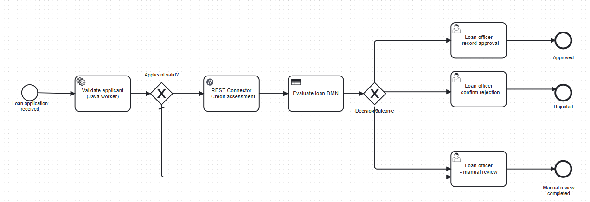
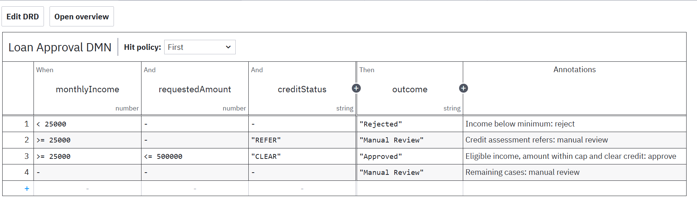
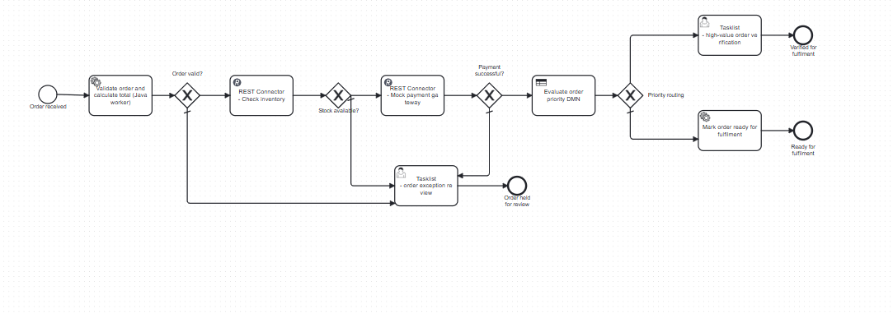
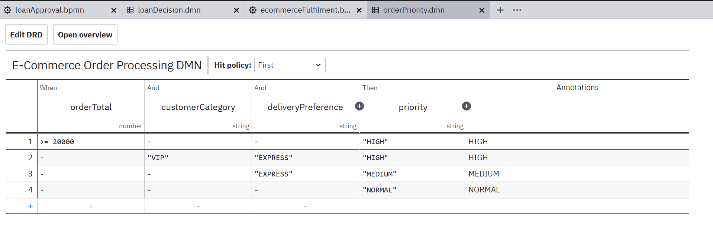

<div align="center">

# Camunda 8 — Workflow Automation Labs

**End-to-end workflow automation using BPMN 2.0, DMN, REST Connectors, and Java workers**

[](https://camunda.com/)
[](https://www.java.com/)
[](https://spring.io/projects/spring-boot)
[](https://maven.apache.org/)

A practical implementation of two business workflows, combining process orchestration, decision automation, external API integration, and human-in-the-loop tasks.

</div>

---

## Project dashboard

| Lab | Workflow | Core capabilities | Main outcome |
|:---:|---|---|---|
| **01** | Loan Approval | BPMN orchestration, Java validation worker, credit REST API, DMN decision table, human review | Approved, rejected, or manual review |
| **02** | E-Commerce Order Processing | Java order validation, inventory REST API, payment REST API, DMN priority routing, exception and verification tasks | Fulfilment, exception review, or high-value verification |

### At a glance

- **2** executable BPMN process models
- **2** DMN decision tables
- **3** Java job workers
- **3** mock REST API endpoints
- Human tasks for loan decisions, order exceptions, and high-value verification

---

## Architecture overview

```text
                         CAMUNDA 8
                Process orchestration / execution
                              |
             +----------------+----------------+
             |                                 |
        LAB 1: LOAN                       LAB 2: E-COMMERCE
             |                                 |
      Validate applicant                 Validate order
       (Java worker)                      (Java worker)
             |                                 |
      Credit assessment                  Inventory REST API
       (REST Connector)                        |
             |                           Payment REST API
       Loan Approval DMN                       |
             |                         Order Priority DMN
     Approval / Rejection                      |
       / Manual Review                Fulfilment / Review
```

### Technology stack

| Component | Technology | Responsibility |
|---|---|---|
| Workflow engine | Camunda 8 | BPMN process execution and orchestration |
| Process modelling | BPMN 2.0 | Defines workflow sequence, gateways, service tasks, and user tasks |
| Decision automation | DMN | Evaluates loan outcomes and order priority |
| Backend | Java + Spring Boot | Implements workers and mock API services |
| Workflow integration | Zeebe Java Client | Connects Java workers to Camunda |
| API integration | Camunda REST Connector | Calls credit, inventory, and payment endpoints |
| Build | Maven | Builds and runs the Java worker application |

---

# Lab 01 — End-to-End Loan Approval

## BPMN process

The loan workflow validates an applicant, requests a credit assessment, evaluates the decision table, and routes the application to the appropriate human task or outcome.

<p align="center">
  
</p>

## Loan Approval DMN

The decision table uses a **First** hit policy and evaluates monthly income, requested amount, and credit status.

<p align="center">
  
</p>

### Decision outcomes

| Condition | Outcome |
|---|---|
| Monthly income below 25,000 | Rejected |
| Income at least 25,000 and credit status is `REFER` | Manual Review |
| Income at least 25,000, requested amount at most 500,000, and credit status is `CLEAR` | Approved |
| Remaining cases | Manual Review |

### Workflow stages

1. Receive loan application.
2. Validate applicant details using the `validate-loan` Java worker.
3. Route invalid applications to manual review.
4. Call the credit assessment REST endpoint using a Camunda REST Connector.
5. Evaluate the loan approval DMN.
6. Route the result to approval, rejection, or manual review.

---

# Lab 02 — E-Commerce Order Processing

## BPMN process

The e-commerce workflow validates an order, checks stock, processes payment, evaluates order priority, and routes the order to fulfilment or a human review task.

<p align="center">
  
</p>

## Order Priority DMN

The decision table uses a **First** hit policy and evaluates order total, customer category, and delivery preference.

<p align="center">
  
</p>

### Priority rules

| Condition | Priority |
|---|---|
| Order total at least 20,000 | `HIGH` |
| VIP customer with EXPRESS delivery | `HIGH` |
| EXPRESS delivery (when earlier rules do not match) | `MEDIUM` |
| Remaining orders | `NORMAL` |

### Workflow stages

1. Receive order.
2. Validate order details and calculate total using the `validate-order` Java worker.
3. Check inventory through a Camunda REST Connector.
4. Route unavailable stock to order exception review.
5. Process payment through a Camunda REST Connector.
6. Route declined payments to order exception review.
7. Evaluate order priority using the `orderPriority` DMN.
8. Route high-priority orders to human verification; route other orders to fulfilment.
9. Mark the order ready for fulfilment using the `mark-fulfilment` Java worker.

---

## Java workers and mock APIs

The Spring Boot application exposes mock endpoints used by the REST Connector tasks.

| Type | Name / endpoint | Purpose |
|---|---|---|
| Job worker | `validate-loan` | Validates loan applicant input |
| Job worker | `validate-order` | Validates order input and calculates `orderTotal` |
| Job worker | `mark-fulfilment` | Marks an order as ready for fulfilment |
| REST API | `POST /api/credit-assessment` | Returns a mock credit assessment |
| REST API | `POST /api/inventory/check` | Checks product availability |
| REST API | `POST /api/payment` | Simulates payment success or decline |

The mock API is intended for local learning and demonstration; it is not a production payment, inventory, or credit service.

---

## Repository structure

```text
Camunda8_Labs_1_and_2/
├── models/
│   ├── lab1-loan/
│   │   ├── loanApproval.bpmn
│   │   └── loanDecision.dmn
│   └── lab2-ecommerce/
│       ├── ecommerceFulfilment.bpmn
│       └── orderPriority.dmn
├── worker/
│   ├── src/
│   │   └── main/
│   │       ├── java/
│   │       └── resources/
│   └── pom.xml
├── docs/
│   └── images/
│       ├── lab1-loan-approval-bpmn.png
│       ├── lab1-loan-approval-dmn.png
│       ├── lab2-ecommerce-bpmn.png
│       └── lab2-order-priority-dmn.png
└── README.md
```

---

## Run locally

### Prerequisites

- Java 17 or compatible runtime
- Maven
- Camunda 8 local runtime (the project was developed with Camunda 8.8)
- Camunda Modeler (recommended for viewing and editing BPMN/DMN models)

### 1. Start Camunda 8

Start your local Camunda 8.8 runtime using the startup command for your installed distribution. Keep its terminal running.

### 2. Start the Java worker application

From the repository root:

```powershell
cd worker
mvn spring-boot:run
```

The Spring Boot application runs locally on port `8081` (as configured in the project).

### 3. Open Camunda applications

| Application | Local URL |
|---|---|
| Operate | http://localhost:8080/operate |
| Tasklist | http://localhost:8080/tasklist |
| Identity | http://localhost:8080/identity |
| Orchestration API | http://localhost:8080/v2/ |

For the local demo runtime used during development, the login was `demo` / `demo`.

### 4. Deploy the BPMN and DMN resources

Deploy the BPMN and DMN files to the local Camunda 8 Orchestration Cluster API. Example for the Lab 2 BPMN, run from the `worker` directory:

```powershell
curl.exe -X POST "http://localhost:8080/v2/deployments" `
  -H "Accept: application/json" `
  -F "resources=@..\models\lab2-ecommerce\ecommerceFulfilment.bpmn;type=application/xml"
```

Deploy the other BPMN and DMN resources in the same way, using their respective file paths.

### 5. Start a process instance

Example Lab 2 successful-order test:

```powershell
$body = @{
    processDefinitionId = "ecommerceFulfilment"
    variables = @{
        customerRef = "CUST005"
        productId = "ITEM001"
        quantity = 2
        unitPrice = 1500
        paymentToken = "TEST_SUCCESS"
        customerCategory = "REGULAR"
        deliveryPreference = "STANDARD"
    }
} | ConvertTo-Json -Depth 5

Invoke-RestMethod `
    -Uri "http://localhost:8080/v2/process-instances" `
    -Method POST `
    -ContentType "application/json" `
    -Body $body
```

Use Operate to inspect process instances, variables, and incidents. Use Tasklist to work on active user tasks.

---

## Demonstration scenarios

| Lab | Scenario | Expected route |
|---|---|---|
| Loan | Income below minimum | Rejected |
| Loan | Eligible income and clear credit | Approved |
| Loan | Credit assessment returns `REFER` | Manual review |
| E-commerce | Valid order, stock available, payment successful, normal priority | Ready for fulfilment |
| E-commerce | Product unavailable | Order exception review |
| E-commerce | Payment declined | Order exception review |
| E-commerce | Order total at least 20,000 | High-value order verification |

---

## Notes

- The REST endpoints are mock services for demonstration.
- Camunda runtime data and local credentials are not part of this repository.
- Deploy the BPMN and DMN resources before starting new process instances.
- Existing process instances continue using the process version with which they were started; redeploying a model does not rewrite running instances.

---

<div align="center">

**Camunda 8 Practical Assignment — Labs 1 & 2**

*Workflow orchestration • Decision automation • REST integration • Human-in-the-loop processing*

</div>
